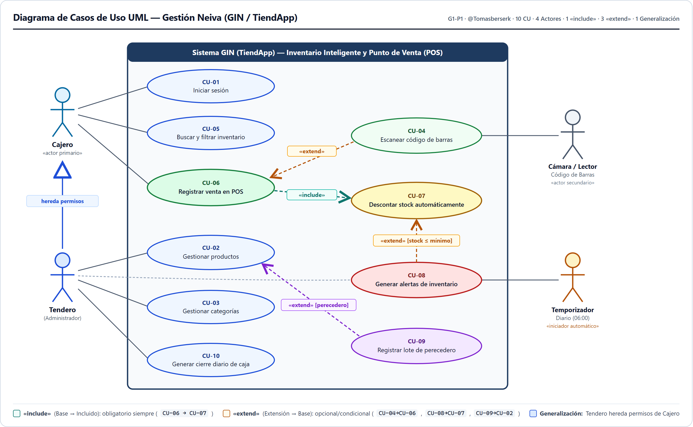

# Matriz Requisito → Caso de Uso y Justificación de Relaciones — GIN (TiendApp)

**Producto:** G1-P1 · Plan de análisis y casos de uso  
**Autor (GitHub):** `@Tomasberserk`  
**Cobertura funcional:** **10 / 10 requisitos funcionales cubiertos (100 %)**

---

## 1. Matriz Requisito Funcional (RF) → Caso de Uso (CU)

| ID RF | Requisito Funcional (resumen) | Caso(s) de Uso que lo atiende(n) | Actor(es) involucrados | Estado |
| :---: | :--- | :--- | :--- | :---: |
| **RF-01** | Gestión de productos (CRUD con precio costo/venta, unidad y stock mínimo) | `CU-02 Gestionar productos` | Tendero | Cubierto |
| **RF-02** | Categorización personalizable de productos | `CU-03 Gestionar categorías` | Tendero | Cubierto |
| **RF-03** | Lectura/escaneo de código de barras (cámara o manual) | `CU-04 Escanear código de barras` | Tendero, Cajero, Cámara / Lector *(sec.)* | Cubierto |
| **RF-04** | Búsqueda y filtrado de inventario en tiempo real | `CU-05 Buscar y filtrar inventario` | Tendero, Cajero | Cubierto |
| **RF-05** | Descuento automático de inventario al confirmar venta | `CU-07 Descontar stock automáticamente` | Iniciado por `«include»` desde `CU-06` | Cubierto |
| **RF-06** | Alertas de stock bajo (`stock_actual ≤ stock_minimo`) | `CU-08 Generar alertas de inventario` | Iniciado por `«extend»` desde `CU-07` y `Temporizador Diario` | Cubierto |
| **RF-07** | Autenticación y control de acceso por rol multi-tienda | `CU-01 Iniciar sesión` | Tendero, Cajero | Cubierto |
| **RF-08** | Registro de venta en Punto de Venta (POS) con carrito y pago | `CU-06 Registrar venta en POS` | Cajero, Tendero | Cubierto |
| **RF-09** | Control de lotes y alertas de vencimiento (≤ 15 días) | `CU-09 Registrar lote de perecedero` y `CU-08 Generar alertas de inventario` | Tendero (`CU-09`), `Temporizador Diario` (`CU-08`) | Cubierto |
| **RF-10** | Cierre diario de caja y exportación de reporte de ventas | `CU-10 Generar cierre diario de caja` | Tendero | Cubierto |

> **Nota sobre agrupación CRUD (Criterio de arbitraje 1):** En `CU-02 Gestionar productos` y `CU-03 Gestionar categorías` las operaciones Crear/Consultar/Editar/Desactivar se agrupan en un solo objetivo del actor Tendero, evitando fragmentar el diagrama en casos técnicos redundantes.

---

## 2. Distinción frente a Requisitos No Funcionales (RNF)

Los siguientes requisitos **NO** generan casos de uso propios porque describen cualidades transversales del sistema (rendimiento, usabilidad, compatibilidad, seguridad y escalabilidad) que restringen la ejecución de todos los casos anteriores:

| ID RNF | Categoría | Cómo restringe a los Casos de Uso |
| :---: | :--- | :--- |
| **RNF-01** | Rendimiento | Limita `CU-05` (`< 500 ms`), `CU-04` (`< 1 s`) y `CU-06` (`< 15 s` por venta completa). |
| **RNF-02** | Usabilidad responsiva | Aplica a las vistas de todos los casos (`CU-01` a `CU-10`) en escritorio y celular. |
| **RNF-03** | Compatibilidad | Define navegadores y sistemas operativos soportados para acceder al sistema. |
| **RNF-04** | Seguridad y aislamiento | Exige que todos los casos posteriores a `CU-01` validen rol y pertenencia a la tienda (`403` ante acceso cruzado). |
| **RNF-05** | Escalabilidad | Exige que `CU-05` y `CU-02` mantengan `< 500 ms` con hasta 10 000 productos. |

---

## 3. Justificación de Relaciones UML (`«include»`, `«extend»` y Generalización)

| Relación | Origen → Destino | Tipo | Justificación en una línea (según Sección 7 de `Rubricas_G1.md`) |
| :---: | :--- | :---: | :--- |
| **R1** | `CU-06 Registrar venta en POS` → `CU-07 Descontar stock automáticamente` | `«include»` | Es obligatorio: **toda** venta confirmada en el POS siempre debe descontar el inventario de los productos vendidos. |
| **R2** | `CU-04 Escanear código de barras` → `CU-06 Registrar venta en POS` | `«extend»` | Es opcional/condicional (punto de extensión *Agregar ítem*): solo ocurre cuando el producto tiene código de barras y el cajero decide escanearlo en lugar de buscarlo manualmente. |
| **R3** | `CU-08 Generar alertas de inventario` → `CU-07 Descontar stock automáticamente` | `«extend»` | Es condicional (punto de extensión *Evaluar umbral*): solo se dispara tras el descuento cuando el stock resultante queda en `cantidad_actual ≤ stock_minimo`. |
| **R4** | `CU-09 Registrar lote de perecedero` → `CU-02 Gestionar productos` | `«extend»` | Es condicional (punto de extensión *Registrar vencimiento*): solo aplica cuando el producto registrado es perecedero y requiere fecha de caducidad por lote. |
| **R5** | `Tendero` → `Cajero` *(Generalización de actor)* | Generalización | El Tendero hereda todas las capacidades operativas de caja del Cajero (`CU-01`, `CU-04`, `CU-05`, `CU-06`) y añade la administración del catálogo, lotes y cierre de caja. |

---

## 4. Diagrama de Casos de Uso UML

- **Fuente editable (Draw.io):** [`04-diagrama-casos-uso.drawio`](./04-diagrama-casos-uso.drawio)
- **Imagen exportada:** [`04-diagrama-casos-uso.png`](./04-diagrama-casos-uso.png)

