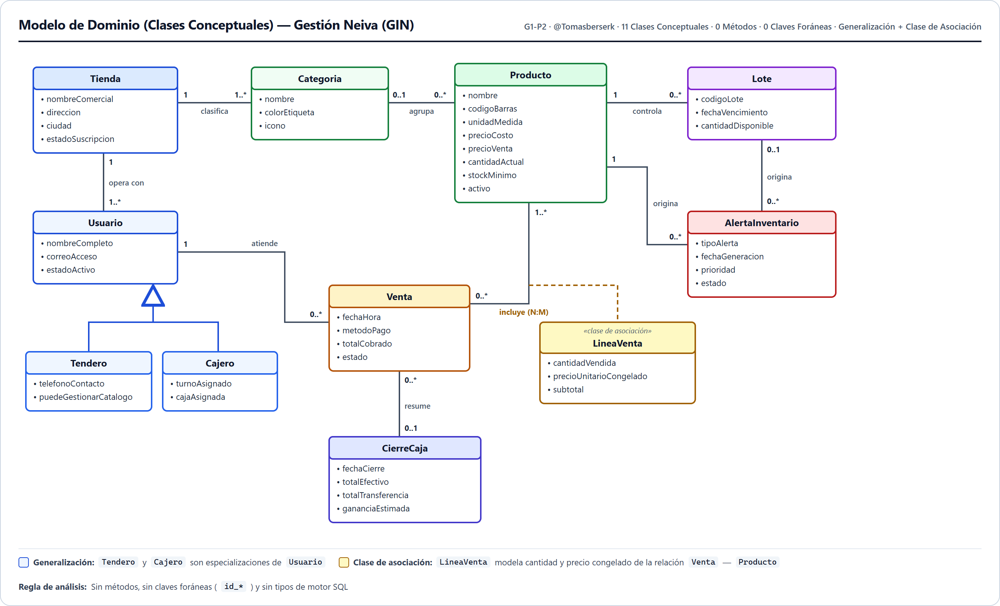

# Modelo de Dominio (Clases Conceptuales) — GIN (TiendApp)

**Producto:** G1-P2 · Modelo de análisis y verificación  
**Autor (GitHub):** `@Tomasberserk`  
**Fuente editable:** [`03-modelo-dominio.drawio`](./03-modelo-dominio.drawio)  
**Imagen exportada:** [`03-modelo-dominio.png`](./03-modelo-dominio.png)

---

## 1. Reglas de Modelado Aplicadas
- Representa únicamente **conceptos del negocio** presentes en el SRS y en las plantillas extendidas de casos de uso.
- **Sin detalles de implementación:** no contiene métodos, no contiene claves primarias ni foráneas (`id_*`) y no contiene tipos de motor SQL.
- Incluye **11 clases conceptuales** (mínimo exigido: 8), **generalización** (`Usuario` → `Tendero`, `Cajero`) y **clase de asociación** (`LineaVenta` entre `Venta` y `Producto`).

---

## 2. Catálogo de Clases Conceptuales y Atributos de Negocio

| # | Clase Conceptual | Tipo especial | Atributos de negocio | Relación con el negocio |
| :-: | :--- | :--- | :--- | :--- |
| 1 | **Tienda** | Raíz del dominio | `nombreComercial`, `direccion`, `ciudad`, `estadoSuscripcion` | Representa cada comercio de barrio que aísla su catálogo y ventas. |
| 2 | **Usuario** | Superclase (Generalización) | `nombreCompleto`, `correoAcceso`, `estadoActivo` | Persona autorizada para operar dentro de una tienda. |
| 3 | **Tendero** | Subclase de `Usuario` | `telefonoContacto`, `puedeGestionarCatalogo` | Propietario o administrador que gestiona productos, lotes, alertas y cierre de caja. |
| 4 | **Cajero** | Subclase de `Usuario` | `turnoAsignado`, `cajaAsignada` | Operador de mostrador autorizado para registrar ventas en el POS. |
| 5 | **Categoria** | Concepto de catálogo | `nombre`, `colorEtiqueta`, `icono` | Agrupación personalizable de productos dentro de una tienda. |
| 6 | **Producto** | Concepto central | `nombre`, `codigoBarras`, `unidadMedida`, `precioCosto`, `precioVenta`, `cantidadActual`, `stockMinimo`, `activo` | Artículo comercializado en la tienda. |
| 7 | **Lote** | Concepto dependiente | `codigoLote`, `fechaVencimiento`, `cantidadDisponible` | Existencia perecedera de un producto con fecha de caducidad propia. |
| 8 | **Venta** | Transacción comercial | `fechaHora`, `metodoPago`, `totalCobrado`, `estado` | Compra confirmada por un cliente en mostrador. |
| 9 | **LineaVenta** | **Clase de asociación** (`Venta`–`Producto`) | `cantidadVendida`, `precioUnitarioCongelado`, `subtotal` | Registra cuántos ítems y a qué precio exacto se vendió cada producto dentro de una venta. |
| 10 | **AlertaInventario** | Evento operativo | `tipoAlerta`, `fechaGeneracion`, `prioridad`, `estado` | Notificación de stock bajo o vencimiento próximo (≤ 15 días). |
| 11 | **CierreCaja** | Resumen financiero | `fechaCierre`, `totalEfectivo`, `totalTransferencia`, `gananciaEstimada` | Consolidado diario de las ventas registradas en una tienda. |

---

## 3. Asociaciones y Multiplicidades Principales
- `Tienda` **1** — opera con — **1..\*** `Usuario`
- `Tendero` y `Cajero` **heredan** de `Usuario` *(generalización: relación «es un»)*
- `Tienda` **1** — clasifica con — **1..\*** `Categoria`
- `Tienda` **1** — ofrece — **0..\*** `Producto`
- `Categoria` **0..1** — agrupa — **0..\*** `Producto`
- `Producto` **1** — controla vencimiento mediante — **0..\*** `Lote`
- `Tienda` **1** — registra — **0..\*** `Venta`
- `Usuario` **1** — atiende — **0..\*** `Venta`
- `Venta` **0..\*** — incluye — **1..\*** `Producto` *(asociación detallada por la clase de asociación **`LineaVenta`**)*
- `Producto` **1** — origina — **0..\*** `AlertaInventario`
- `Lote` **0..1** — origina — **0..\*** `AlertaInventario`
- `Tienda` **1** — consolida — **0..\*** `CierreCaja`
- `CierreCaja` **0..1** — resume — **0..\*** `Venta`
