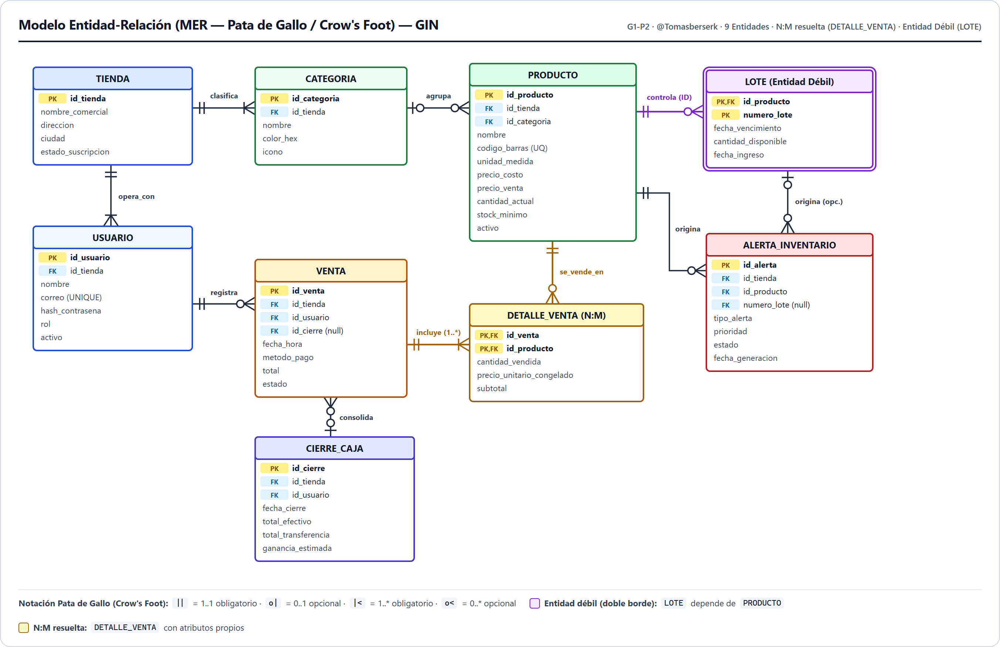

# Modelo Entidad-Relación (MER) — GIN (TiendApp)

**Producto:** G1-P2 · Modelo de análisis y verificación  
**Autor (GitHub):** `@Tomasberserk`  
**Notación declarada:** **Pata de gallo (Crow's Foot / Ingeniería de la Información — IE)** con cardinalidad mínima y máxima explícita (`||` = exactamente uno obligatorio, `o|` = cero o uno opcional, `|<` = uno o muchos obligatorio, `o<` = cero o muchos opcional).  
**Fuente editable:** [`04-modelo-entidad-relacion.drawio`](./04-modelo-entidad-relacion.drawio)  
**Imagen exportada:** [`04-modelo-entidad-relacion.png`](./04-modelo-entidad-relacion.png)

---

## 1. Entidades, Identificadores y Atributos (9 Entidades)

| # | Entidad | Clasificación | Identificador (PK) | Atributos principales | Requisitos de datos soportados |
| :-: | :--- | :--- | :--- | :--- | :--- |
| 1 | **TIENDA** | Entidad fuerte | `id_tienda` | `nombre_comercial`, `direccion`, `ciudad`, `estado_suscripcion`, `fecha_creacion` | `RF-07`, `RNF-04` |
| 2 | **USUARIO** | Entidad fuerte | `id_usuario` | `id_tienda (FK)`, `nombre`, `correo (UNIQUE)`, `hash_contrasena`, `rol (TENDERO/CAJERO)`, `activo` | `RF-07`, `RNF-04` |
| 3 | **CATEGORIA** | Entidad fuerte | `id_categoria` | `id_tienda (FK)`, `nombre`, `color_hex`, `icono`, `fecha_creacion` | `RF-02` |
| 4 | **PRODUCTO** | Entidad fuerte | `id_producto` | `id_tienda (FK)`, `id_categoria (FK)`, `nombre`, `codigo_barras (UNIQUE por tienda)`, `unidad_medida`, `precio_costo`, `precio_venta`, `cantidad_actual`, `stock_minimo`, `foto_url`, `activo` | `RF-01`, `RF-03`, `RF-04`, `RF-05`, `RF-06` |
| 5 | **LOTE** | **Entidad débil** *(identificada por `id_producto` + `numero_lote`)* | `(id_producto, numero_lote)` | `fecha_vencimiento`, `cantidad_disponible`, `fecha_ingreso` | `RF-09` |
| 6 | **VENTA** | Entidad fuerte | `id_venta` | `id_tienda (FK)`, `id_usuario (FK)`, `id_cierre (FK nullable)`, `fecha_hora`, `metodo_pago`, `total`, `estado` | `RF-08`, `RF-05` |
| 7 | **DETALLE_VENTA** | **Entidad asociativa** *(resuelve N:M `VENTA`–`PRODUCTO`)* | `(id_venta, id_producto)` | `cantidad_vendida`, `precio_unitario_congelado`, `subtotal` | `RF-08`, `RF-05` |
| 8 | **ALERTA_INVENTARIO** | Entidad fuerte | `id_alerta` | `id_tienda (FK)`, `id_producto (FK)`, `numero_lote (FK nullable)`, `tipo_alerta`, `prioridad`, `estado`, `fecha_generacion`, `fecha_resolucion` | `RF-06`, `RF-09` |
| 9 | **CIERRE_CAJA** | Entidad fuerte | `id_cierre` | `id_tienda (FK)`, `id_usuario (FK)`, `fecha_cierre`, `total_efectivo`, `total_transferencia`, `ganancia_estimada` | `RF-10` |

---

## 2. Relaciones, Cardinalidad y Participación

| Relación | Entidad A | Cardinalidad y Participación | Entidad B | Regla de negocio |
| :--- | :--- | :---: | :--- | :--- |
| opera_con | `TIENDA` | `1..1 (||)` ——— `1..* (|<)` | `USUARIO` | Toda tienda tiene al menos un usuario (Tendero); cada usuario pertenece exactamente a una tienda. |
| clasifica_con | `TIENDA` | `1..1 (||)` ——— `1..* (|<)` | `CATEGORIA` | Cada tienda posee sus propias categorías (predefinidas o creadas). |
| ofrece | `TIENDA` | `1..1 (||)` ——— `0..* (o<)` | `PRODUCTO` | Aislamiento multi-tienda del catálogo de productos. |
| agrupa | `CATEGORIA` | `0..1 (o|)` ——— `0..* (o<)` | `PRODUCTO` | Un producto puede pertenecer a una categoría; si la categoría se elimina, el producto queda sin categoría (`NULL`). |
| controla_por | `PRODUCTO` | `1..1 (||)` ——— `0..* (o<)` | **`LOTE` *(débil)*** | **Entidad débil:** un lote no tiene existencia independiente sin su `PRODUCTO` padre; se identifica parcialmente por `numero_lote` dentro de `id_producto`. |
| registra | `USUARIO` | `1..1 (||)` ——— `0..* (o<)` | `VENTA` | Cada venta es atendida obligatoriamente por un usuario autenticado. |
| incluye *(N:M resuelta)* | `VENTA` | `1..1 (||)` ——— `1..* (|<)` | **`DETALLE_VENTA`** | **Relación N:M resuelta:** una venta incluye 1 o muchos productos y un producto aparece en 0 o muchas ventas; `DETALLE_VENTA` porta atributos propios (`cantidad_vendida`, `precio_unitario_congelado`, `subtotal`). |
| se_vende_en *(N:M resuelta)* | `PRODUCTO` | `1..1 (||)` ——— `0..* (o<)` | **`DETALLE_VENTA`** | Segundo brazo de la entidad asociativa `DETALLE_VENTA`. |
| origina | `PRODUCTO` | `1..1 (||)` ——— `0..* (o<)` | `ALERTA_INVENTARIO` | Cada alerta referencia obligatoriamente al producto afectado (y opcionalmente al `LOTE` si es de vencimiento). |
| consolida | `CIERRE_CAJA` | `0..1 (o|)` ——— `0..* (o<)` | `VENTA` | Las ventas del día se asocian a su cierre de caja al finalizar la jornada. |
