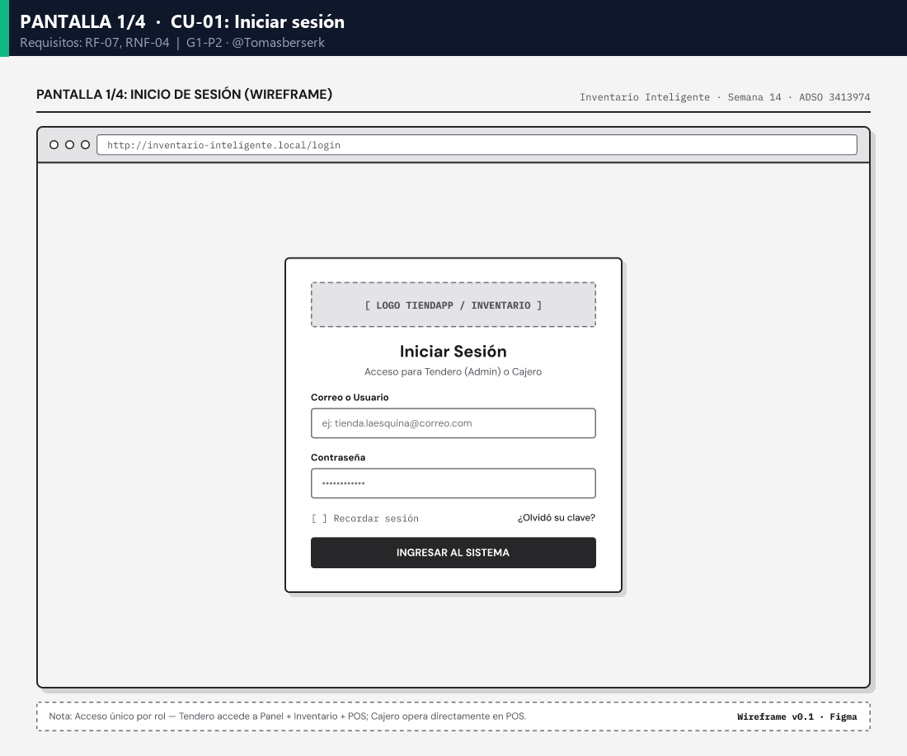
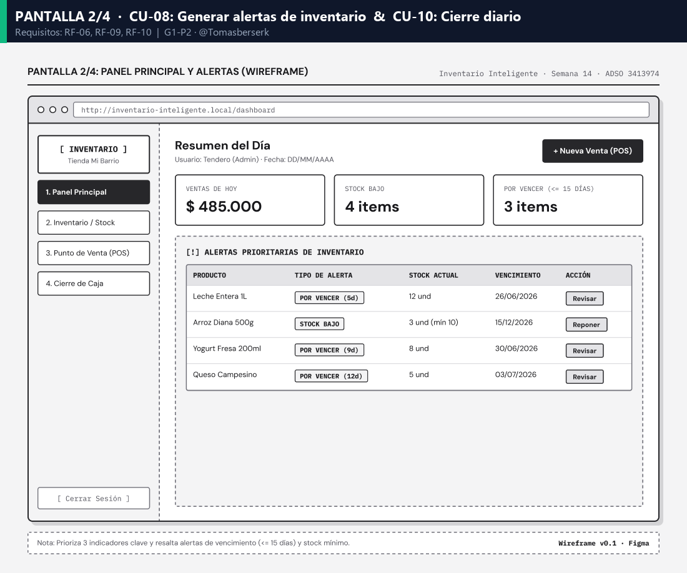
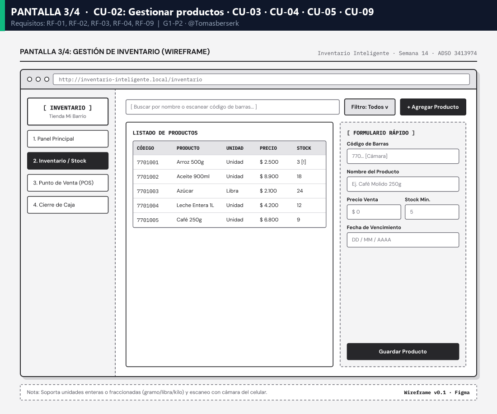
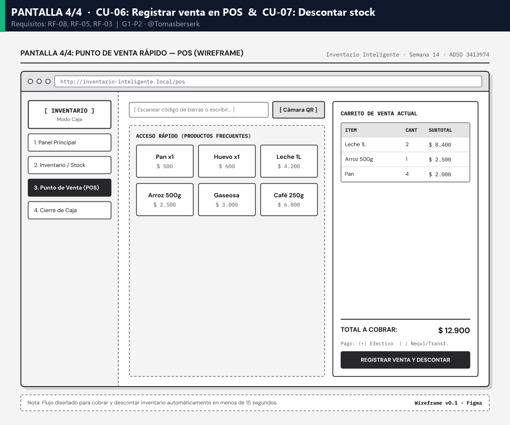

# Prototipo Inicial (Mockup Baja Fidelidad) Rotulado por Caso de Uso — GIN (TiendApp)

**Producto:** G1-P2 · Modelo de análisis y verificación  
**Autor (GitHub):** `@Tomasberserk`  
**Origen reutilizado:** Reutilizado y rotulado desde [`03-execute/14-week/02-optional-activity/Mockup_Sencillo_Inventario_Inteligente.pdf`](../../../../../03-execute/14-week/02-optional-activity/Mockup_Sencillo_Inventario_Inteligente.pdf) (diseñado en Figma como wireframe de baja fidelidad).

---

## Mapa de Pantallas → Casos de Uso (0 pantallas huérfanas)

| Pantalla | Archivo de imagen | Caso(s) de Uso que atiende | Requisitos cubiertos |
| :---: | :--- | :--- | :--- |
| **Pantalla 1/4** | [`prototipo/pantalla-01-cu01-login.png`](./prototipo/pantalla-01-cu01-login.png) | **`CU-01 · Iniciar sesión`** | `RF-07`, `RNF-04` |
| **Pantalla 2/4** | [`prototipo/pantalla-02-cu08-alertas-dashboard.png`](./prototipo/pantalla-02-cu08-alertas-dashboard.png) | **`CU-08 · Generar alertas de inventario`** y acceso a **`CU-10 · Generar cierre diario de caja`** | `RF-06`, `RF-09`, `RF-10` |
| **Pantalla 3/4** | [`prototipo/pantalla-03-cu02-inventario.png`](./prototipo/pantalla-03-cu02-inventario.png) | **`CU-02 · Gestionar productos`**, `CU-03`, `CU-04`, `CU-05` y `CU-09` | `RF-01`, `RF-02`, `RF-03`, `RF-04`, `RF-09` |
| **Pantalla 4/4** | [`prototipo/pantalla-04-cu06-venta-pos.png`](./prototipo/pantalla-04-cu06-venta-pos.png) | **`CU-06 · Registrar venta en POS`** y **`CU-07 · Descontar stock automáticamente`** | `RF-08`, `RF-05`, `RF-03` |

---

### Pantalla 1/4 — `CU-01`: Inicio de Sesión

### Pantalla 2/4 — `CU-08`: Panel Principal y Alertas

### Pantalla 3/4 — `CU-02`, `CU-03`, `CU-04`, `CU-05` y `CU-09`: Gestión de Inventario

### Pantalla 4/4 — `CU-06` y `CU-07`: Punto de Venta (POS)

