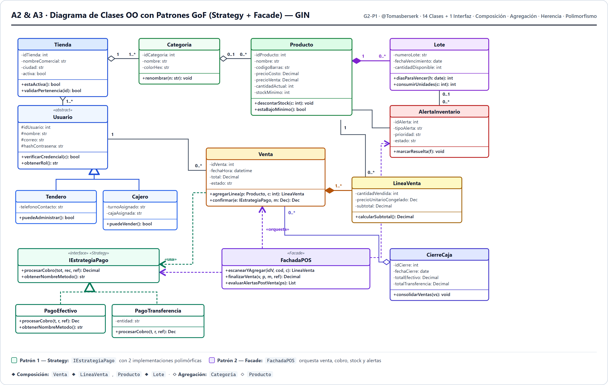
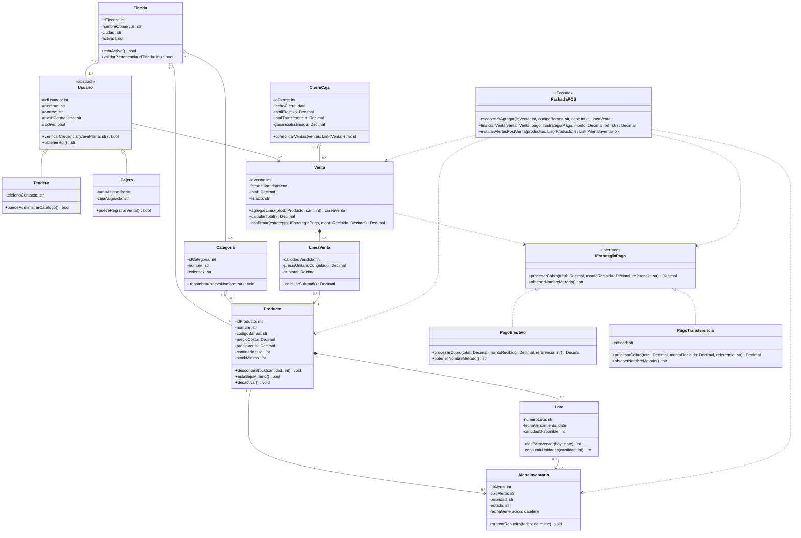

# A2 y A3 · Diagrama de Clases OO y Patrones de Diseño GoF — GIN (TiendApp)

**Producto:** G2-P1 · Artefactos de diseño  
**Autor (GitHub):** `@Tomasberserk`  
**Fuente editable (Draw.io):** [`02-diagrama-clases.drawio`](./02-diagrama-clases.drawio)  
**Imagen exportada:** [`02-diagrama-clases.png`](./02-diagrama-clases.png)

---

## 1. Principios de Diseño Orientado a Objetos Aplicados (A2)

1. **Alta cohesión y separación de responsabilidades (Regla 5 de `Rubricas_G2.md`):** ninguna clase mezcla interfaz de usuario, lógica de negocio, persistencia, cobro, notificaciones o reportes:
   - **Entidades de dominio:** `Tienda`, `Usuario`, `Tendero`, `Cajero`, `Categoria`, `Producto`, `Lote`, `Venta`, `LineaVenta`.
   - **Cobro (polimorfismo):** interfaz `IEstrategiaPago` con implementaciones `PagoEfectivo` y `PagoTransferencia`.
   - **Notificaciones/alertas:** `AlertaInventario` y `ServicioAlertas`.
   - **Reportes financieros:** `CierreCaja`.
   - **Orquestación de entrada POS:** `FachadaPOS` (coordina venta, cobro, stock y alertas sin asumir persistencia ni UI).
2. **Encapsulamiento:** todos los atributos son privados (`-`) o protegidos (`#` en superclase `Usuario`) y se operan mediante métodos públicos (`+`) tipados con parámetros y tipo de retorno explícito.
3. **Relaciones OO con criterio semántico:**
   - **Composición (`◆──`):** `Venta` **1** ◆── **1..\*** `LineaVenta` (una línea de venta no existe sin su venta contenedora; si se anula la venta, desaparecen sus líneas).
   - **Composición (`◆──`):** `Producto` **1** ◆── **0..\*** `Lote` (un lote perecedero pertenece exclusivamente a un producto).
   - **Agregación (`◇──`):** `Categoria` **0..1** ◇── **0..\*** `Producto` (si se elimina una categoría, los productos siguen existiendo en el catálogo sin categoría).
   - **Herencia («es un»):** `Tendero` y `Cajero` heredan de `Usuario`.
   - **Realización de interfaz (polimorfismo):** `PagoEfectivo` y `PagoTransferencia` implementan `IEstrategiaPago`.

---

## 2. Catálogo de Clases, Atributos Tipados, Métodos y Trazabilidad (14 Clases + 1 Interfaz)

| # | Clase / Interfaz | Responsabilidad única (Área) | Relación OO clave | Requisitos |
| :-: | :--- | :--- | :--- | :--- |
| 1 | `Tienda` | Aislamiento multi-tienda del comercio (Dominio) | Agrega `Usuario`, `Categoria`, `Producto` | `RF-07`, `RNF-04` |
| 2 | `Usuario` *(abstracta)* | Identidad y verificación de credenciales (Dominio) | Superclase de `Tendero` y `Cajero` | `RF-07`, `RNF-04` |
| 3 | `Tendero` | Operaciones administrativas de catálogo, lotes y cierres (Dominio) | Hereda de `Usuario` | `RF-01`, `RF-02`, `RF-09`, `RF-10` |
| 4 | `Cajero` | Operación de caja y registro de ventas POS (Dominio) | Hereda de `Usuario` | `RF-04`, `RF-08` |
| 5 | `Categoria` | Agrupación visual de productos por tienda (Dominio) | Agregación hacia `Producto` (`0..1 : 0..*`) | `RF-02`, `RF-04` |
| 6 | `Producto` | Datos comerciales, código de barras y control de stock (Dominio) | Composición hacia `Lote` (`1 : 0..*`) | `RF-01`, `RF-03`, `RF-04`, `RF-05` |
| 7 | `Lote` | Control de vencimiento y descuento FEFO de perecederos (Dominio) | Parte de `Producto` | `RF-09`, `RF-05` |
| 8 | `Venta` | Transacción de compra, cálculo de total y estado (Dominio) | Composición hacia `LineaVenta`; usa `IEstrategiaPago` | `RF-08`, `RF-05` |
| 9 | `LineaVenta` | Detalle de ítem con precio unitario congelado (Dominio) | Parte de `Venta`; referencia a `Producto` | `RF-08`, `RF-05` |
| 10 | `IEstrategiaPago` *(«interface»)* | Contrato polimórfico para validar y calcular cobros (Cobro) | Implementada por `PagoEfectivo` y `PagoTransferencia` | `RF-08` |
| 11 | `PagoEfectivo` | Valida monto recibido y calcula cambio en efectivo (Cobro) | Implementa `IEstrategiaPago` | `RF-08` |
| 12 | `PagoTransferencia` | Valida código de comprobante Nequi/Daviplata/Bancolombia (Cobro) | Implementa `IEstrategiaPago` | `RF-08` |
| 13 | `AlertaInventario` | Registro y ciclo de vida de alerta de stock o vencimiento (Notificación) | Asociada a `Producto` y opcionalmente `Lote` | `RF-06`, `RF-09` |
| 14 | `CierreCaja` | Consolidación diaria de ingresos por medio de pago y ganancia (Reportes) | Agrupa `Venta` (`0..1 : 0..*`) | `RF-10` |
| 15 | `FachadaPOS` *(«Facade»)* | Orquesta el flujo completo de venta: carrito, cobro, descuento y alertas (Lógica POS) | Coordina `Venta`, `IEstrategiaPago`, `Producto`, `AlertaInventario` | `RF-03`, `RF-05`, `RF-06`, `RF-08` |

---

## 3. Fuente Editable Mermaid (Espejo del archivo `.drawio`)

---

## 4. Patrones de Diseño GoF Aplicados (A3 — 2 Patrones Distintos, Ambos ≠ Singleton)

| Patrón GoF | Problema concreto del caso GIN | Por qué se eligió este patrón | Clases que lo implementan | Qué mejora en mantenibilidad |
| :--- | :--- | :--- | :--- | :--- |
| **1. Estrategia (`Strategy` — Comportamiento)** | En `RF-08` el tendero acepta **Efectivo** (que requiere validar que `montoRecibido >= total` y calcular cambio) y **Transferencia** (Nequi/Daviplata, que valida referencia y no entrega cambio), y en el futuro puede sumar *Fiado a cliente* o *Datáfono*. | Permite encapsular cada regla de cobro en su propia clase detrás de la interfaz `IEstrategiaPago`, desacoplando `Venta` de condicionales `if/elif` por método de pago y aplicando polimorfismo real. | `IEstrategiaPago` *(interfaz)*, `PagoEfectivo`, `PagoTransferencia`, y `Venta` *(contexto)* | Agregar un nuevo medio de pago (ej. `PagoFiado` o `PagoTarjeta`) exige únicamente crear una nueva subclase sin modificar una sola línea de `Venta` ni romper pruebas existentes (Principio Abierto/Cerrado). |
| **2. Fachada (`Facade` — Estructural)** | Confirmar una venta en mostrador (`RF-08`, `RF-05`, `RF-06`, `RF-03`) involucra coordinar 4 subsistemas en orden estricto: validar líneas de `Venta`, ejecutar `IEstrategiaPago`, descontar stock en `Producto`/`Lote` (FEFO) y evaluar `AlertaInventario`. Si la capa de presentación llamara directamente a cada clase, quedaría fuertemente acoplada y podría omitir el descuento de stock. | Expone una interfaz de alto nivel simple (`FachadaPOS.finalizarVenta(...)`) que encapsula la secuencia transaccional completa y garantiza que nunca se confirme una venta sin descontar stock ni evaluar umbrales. | `FachadaPOS` *(fachada)* coordinando `Venta`, `IEstrategiaPago`, `Producto`, `Lote` y `AlertaInventario` | Reduce el acoplamiento de la capa de presentación con el dominio: si cambia la lógica interna de descuento FEFO o el motor de alertas, la interfaz POS sigue llamando exactamente el mismo método `finalizarVenta(...)`. |
