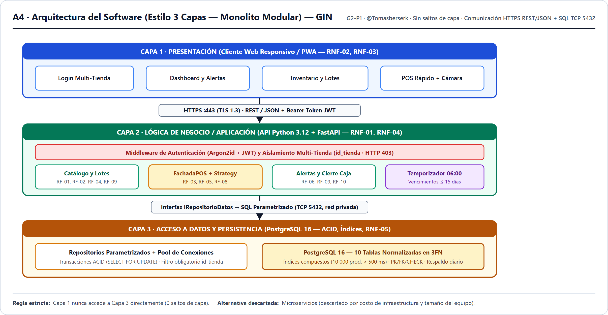
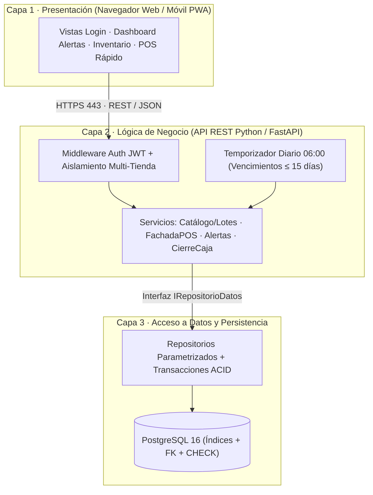

# A4 · Arquitectura del Software y Decisiones frente a RNF — GIN (TiendApp)

**Producto:** G2-P1 · Artefactos de diseño  
**Autor (GitHub):** `@Tomasberserk`  
**Fuente editable (Draw.io):** [`03-arquitectura.drawio`](./03-arquitectura.drawio)  
**Imagen exportada:** [`03-arquitectura.png`](./03-arquitectura.png)

---

## 1. Estilo Arquitectónico y Comunicación

- **Estilo seleccionado:** **Arquitectura en Tres Capas (3-Tier Layered Architecture)** desplegada como monolito modular web:
  1. **Capa de Presentación (SPA / PWA Responsiva):** interfaces de Login, Dashboard de Alertas, Gestión de Inventario y POS Rápido; captura de cámara para códigos de barras.
  2. **Capa de Lógica de Negocio / Aplicación (API REST FastAPI):** controladores HTTP, middleware de autenticación/aislamiento multi-tienda, `FachadaPOS`, estrategias de pago, servicio de catálogo/lotes, motor de alertas y cierre de caja.
  3. **Capa de Acceso a Datos y Persistencia (Repositorios + PostgreSQL 16):** repositorios parametrizados, manejo transaccional ACID y consultas indexadas.
- **Regla estricta de no salto de capas:** la Capa de Presentación **nunca** accede directamente a la base de datos ni a los repositorios; toda operación pasa obligatoriamente por la API de la Capa de Lógica de Negocio y su filtro de autorización por tienda.
- **Estilo de comunicación entre capas:**
  - *Presentación → Lógica de Negocio:* llamadas síncronas **HTTPS (TLS 1.3) REST con carga útil JSON** y encabezado `Authorization: Bearer <token>`.
  - *Lógica de Negocio → Acceso a Datos:* invocaciones de interfaz en proceso (`IRepositorioDatos`) traducidas a **consultas SQL parametrizadas sobre TCP 5432** con pool de conexiones.

---

## 2. Fuente Editable Mermaid (Espejo del archivo `.drawio`)

---

## 3. Tabla de Decisiones Arquitectónicas frente a RNF (5 RNF — mínimo exigido: 3)

| RNF / Estilo | Decisión arquitectónica aplicada en GIN | Alternativa descartada | Razón concreta del descarte |
| :--- | :--- | :--- | :--- |
| **Estilo global (3 Capas — Monolito modular)** | Separar estrictamente Presentación (PWA), Lógica de Negocio (FastAPI modular) y Datos (Repositorios + PostgreSQL) sin saltos de capa. | Arquitectura de microservicios distribuidos (5 servicios + API Gateway + broker). | Introduce sobrecarga operativa, latencia de red y costo de infraestructura inviables para un equipo pequeño y un solo servidor VPS de tiendas de barrio. |
| **RNF-01 (Búsqueda `< 500 ms`, venta `< 15 s`) y RNF-05 (`10 000` productos)** | Crear índices compuestos `(id_tienda, nombre)` y `(id_tienda, codigo_barras)` en PostgreSQL, usar pool de conexiones en FastAPI y debounce de 200 ms en el buscador POS. | Cargar todo el catálogo en memoria del navegador o hacer consultas SQL sin índices (`LIKE '%texto%'` full scan). | En celulares de gama media con 10 000 productos degradaría el rendimiento y rompería el umbral `< 500 ms`. |
| **RNF-04 (Aislamiento multi-tienda, `403` y credenciales seguras)** | Centralizar en Capa 2 un middleware que extrae `id_tienda` y `rol` del token firmado y los inyecta en toda consulta del repositorio; contraseñas con hash + sal (`Argon2id`) y transporte obligatorio por HTTPS/TLS. | Validar el `id_tienda` y el rol únicamente ocultando botones en la interfaz web (Capa 1). | Cualquier usuario podría manipular una petición HTTP directa a la API y consultar o alterar ventas de otra tienda. |
| **RNF-02 y RNF-03 (Usabilidad responsiva y compatibilidad multi-dispositivo)** | Construir Capa 1 como aplicación web responsiva (HTML5/PWA) con acceso estándar a cámara (`MediaDevices`) para lectura de códigos de barras. | Desarrollar dos aplicaciones nativas independientes (Android Kotlin + iOS Swift) y un cliente de escritorio. | Triplicaría el tiempo de desarrollo y mantenimiento, además de obligar a los tenderos a instalar actualizaciones manuales en cada equipo. |
| **Disponibilidad e integridad transaccional (`RF-05`, `RF-08`)** | Ejecutar `FachadaPOS.finalizarVenta()` dentro de una única transacción ACID en PostgreSQL con bloqueo optimista/fila (`SELECT ... FOR UPDATE`) y respaldos nocturnos automáticos. | Actualizar el stock en una segunda petición HTTP separada desde el navegador después de guardar la venta. | Un corte de internet entre ambas peticiones dejaría ventas cobradas sin descontar inventario (inconsistencia contable). |
