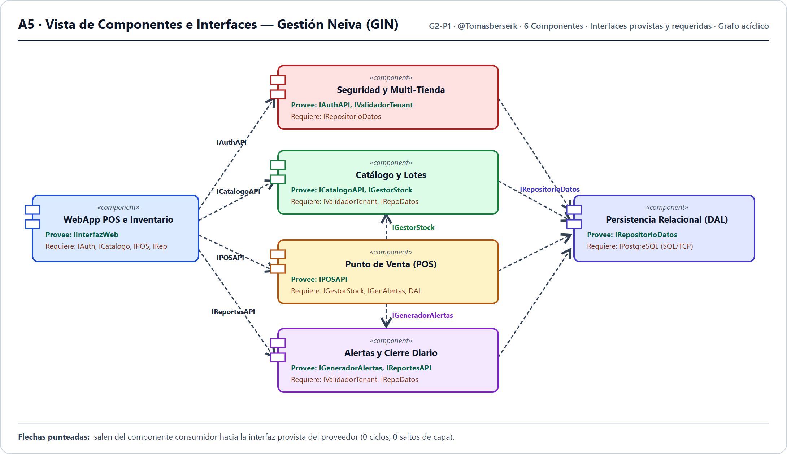
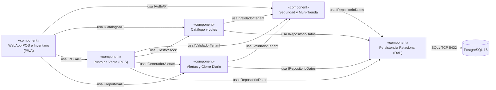

# A5 · Vista de Componentes e Interfaces — GIN (TiendApp)

**Producto:** G2-P1 · Artefactos de diseño  
**Autor (GitHub):** `@Tomasberserk`  
**Fuente editable (Draw.io):** [`04-vista-componentes.drawio`](./04-vista-componentes.drawio)  
**Imagen exportada:** [`04-vista-componentes.png`](./04-vista-componentes.png)

---

## 1. Catálogo de Componentes, Interfaces, Clases y Requisitos (6 Componentes — mínimo exigido: 5)

| # | Componente | Interfaz(es) provista(s) | Interfaz(es) requerida(s) | Clases que agrupa | Requisitos que atiende |
| :-: | :--- | :--- | :--- | :--- | :--- |
| 1 | **WebApp POS e Inventario (PWA)** | `IInterfazWeb` *(UI responsiva)* | `IAuthAPI`, `ICatalogoAPI`, `IPOSAPI`, `IReportesAPI` | Vistas de Login, Dashboard, Inventario y POS *(Capa 1)* | `RNF-02`, `RNF-03`, `RF-03` |
| 2 | **Componente Seguridad y Multi-Tienda** | `IAuthAPI`, `IValidadorTenant` | `IRepositorioDatos` | `Tienda`, `Usuario`, `Tendero`, `Cajero` | `RF-07`, `RNF-04` |
| 3 | **Componente Catálogo y Lotes** | `ICatalogoAPI`, `IGestorStock` | `IValidadorTenant`, `IRepositorioDatos` | `Categoria`, `Producto`, `Lote` | `RF-01`, `RF-02`, `RF-03`, `RF-04`, `RF-09`, `RNF-01`, `RNF-05` |
| 4 | **Componente Punto de Venta (POS)** | `IPOSAPI` | `IValidadorTenant`, `IGestorStock`, `IGeneradorAlertas`, `IRepositorioDatos` | `FachadaPOS`, `Venta`, `LineaVenta`, `IEstrategiaPago`, `PagoEfectivo`, `PagoTransferencia` | `RF-08`, `RF-05`, `RF-03`, `RNF-01` |
| 5 | **Componente Alertas y Cierre Diario** | `IGeneradorAlertas`, `IReportesAPI` | `IValidadorTenant`, `IRepositorioDatos` | `AlertaInventario`, `CierreCaja` | `RF-06`, `RF-09`, `RF-10` |
| 6 | **Componente Persistencia Relacional (DAL)** | `IRepositorioDatos` | `IPostgreSQL` *(driver SQL)* | Repositorios SQL y manejador de transacciones ACID | `RNF-01`, `RNF-04`, `RNF-05` |

---

## 2. Fuente Editable Mermaid (Espejo del archivo `.drawio`)

---

## 3. Reglas de Dependencia Verificadas

- **Dirección correcta:** las flechas salen siempre del componente consumidor (interfaz requerida) hacia el componente proveedor (interfaz provista).
- **Cero dependencias circulares:** el grafo de dependencias es estrictamente acíclico (`WebApp` → `POS` → `Catálogo` / `Alertas` → `Seguridad` → `DAL` → `PostgreSQL`).
- **Cero saltos de capa:** `WebApp POS e Inventario` **no** tiene ninguna flecha hacia `Persistencia Relacional (DAL)` ni hacia `PostgreSQL 16`.
