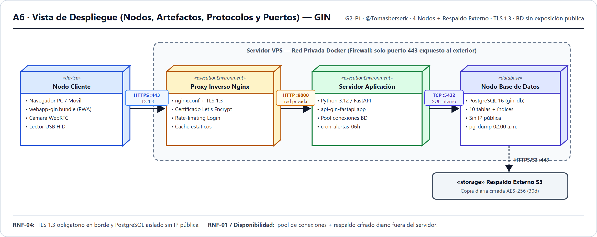
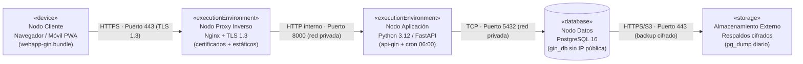

# A6 · Vista de Despliegue — GIN (TiendApp)

**Producto:** G2-P1 · Artefactos de diseño  
**Autor (GitHub):** `@Tomasberserk`  
**Fuente editable (Draw.io):** [`05-vista-despliegue.drawio`](./05-vista-despliegue.drawio)  
**Imagen exportada:** [`05-vista-despliegue.png`](./05-vista-despliegue.png)

---

## 1. Nodos de Despliegue, Artefactos, Protocolos y Decisiones RNF (4 Nodos — mínimo exigido: 3)

| # | Nodo | Artefactos alojados | Conexión (protocolo y puerto) | Decisión que responde a un RNF |
| :-: | :--- | :--- | :--- | :--- |
| 1 | **Nodo Cliente** *(Navegador PC de mostrador o celular Android/iOS)* | `webapp-gin.bundle` (SPA/PWA HTML5 + JS) y módulo de cámara WebRTC / lector USB HID | **HTTPS (TLS 1.3) · Puerto 443** hacia el Proxy Inverso | **RNF-02 / RNF-03 / RNF-04:** ejecución directa sin instalación nativa y tráfico cifrado de extremo a extremo. |
| 2 | **Nodo Proxy Inverso y TLS** *(Contenedor Nginx / DMZ)* | `nginx.conf`, certificados TLS (Let's Encrypt), archivos estáticos cacheados y regla de *rate-limiting* | **HTTP interno · Puerto 8000** (red privada Docker) hacia Servidor de Aplicación | **RNF-04 / RNF-01:** terminación TLS obligatoria, compresión Gzip/Brotli y protección contra fuerza bruta en login (`CU-01`). |
| 3 | **Nodo Servidor de Aplicación** *(Contenedor Python 3.12 / FastAPI)* | `api-gin-fastapi.app` (Uvicorn workers), componentes `Seguridad`, `Catálogo`, `POS`, `Alertas/Cierre` y `cron-alertas-06h` | **TCP (TLS interno) · Puerto 5432** hacia Nodo de Datos | **RNF-01 / RNF-05:** pool de conexiones persistentes hacia PostgreSQL y ejecución asíncrona que mantiene respuestas `< 500 ms`. |
| 4 | **Nodo Base de Datos y Respaldo** *(Contenedor PostgreSQL 16 + Volumen cifrado)* | Instancia `gin_db`, índices compuestos, políticas de roles BD y script `pg_dump` nocturno hacia almacenamiento externo | Solo acepta tráfico interno en **TCP 5432** desde Nodo Aplicación; respaldos salientes por **HTTPS/S3 · Puerto 443** | **RNF-04 y Disponibilidad:** la base de datos no tiene exposición pública a internet (firewall cerrado al exterior) y cuenta con respaldo cifrado diario fuera del servidor. |

---

## 2. Fuente Editable Mermaid (Espejo del archivo `.drawio`)

