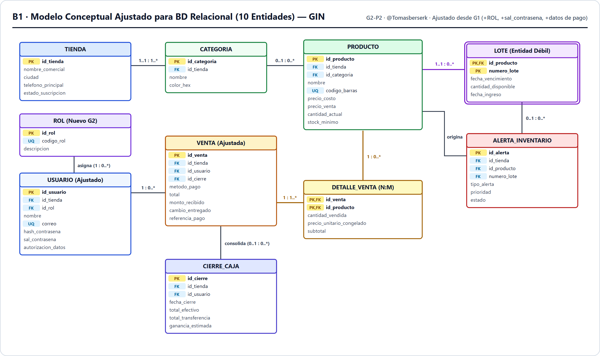

# B1 · Modelo Conceptual Ajustado para Base de Datos Relacional — GIN (TiendApp)

**Producto:** G2-P2 · Modelo de datos y verificación  
**Autor (GitHub):** `@Tomasberserk`  
**Fuente editable (Draw.io):** [`01-modelo-conceptual-ajustado.drawio`](./01-modelo-conceptual-ajustado.drawio)  
**Imagen exportada:** [`01-modelo-conceptual-ajustado.png`](./01-modelo-conceptual-ajustado.png)

---

## 1. Justificación del Tipo de Base de Datos (Relacional — PostgreSQL 16)

1. **Integridad transaccional ACID (`RF-05`, `RF-08`):** el registro de una venta y el descuento de stock en `PRODUCTO` y `LOTE` deben confirmarse o revertirse juntos para impedir existencias negativas o ventas sin descuento.
2. **Estructura relacional fija y aislamiento multi-tienda (`RNF-04`):** las 10 entidades mantienen relaciones estrictas con llaves foráneas y restricciones `UNIQUE` por tienda.
3. **Precisión financiera y consultas indexadas (`RF-10`, `RNF-01`, `RNF-05`):** soporta aritmética exacta `DECIMAL(12,2)` para cierres de caja e índices compuestos para mantener búsquedas `< 500 ms` con `10 000` productos.

---

## 2. Qué se Reutilizó de G1 y Qué se Ajustó en G2

Este modelo reutiliza el MER de `G1-P2-gin/04-modelo-entidad-relacion.drawio` (9 entidades) y aplica **4 ajustes específicos de diseño para la base de datos relacional**:

| # | Ajuste realizado respecto a G1 | Motivo técnico y requisito que atiende |
| :-: | :--- | :--- |
| 1 | **Se extrajo la entidad `ROL`** (`ROL 1..1 ── 0..* USUARIO`) reemplazando el atributo de texto libre `rol` en `USUARIO`. | Elimina valores inconsistentes y prepara la matriz de permisos de ≥ 3 roles (`TENDERO`, `CAJERO`, `AUDITOR_CONTABLE`) exigida por `RNF-04` y `B6`. |
| 2 | **Se agregaron `sal_contrasena`, `telefono_contacto` y `autorizacion_datos` en `USUARIO`.** | Garantiza almacenamiento de contraseñas con **hash y sal** (nunca cifradas ni planas) y registro de autorización de datos personales (Ley 1581). |
| 3 | **Se agregaron `monto_recibido`, `cambio_entregado` y `referencia_pago` en `VENTA`.** | Alinea el modelo de datos con el patrón Estrategia (`PagoEfectivo` y `PagoTransferencia`) definido en `G2-P1-gin/02-diagrama-clases-y-patrones.md` (`RF-08`). |
| 4 | **Se documentó explícitamente el verbo y cardinalidad mínima/máxima** en las 11 relaciones conceptuales, confirmando 1 relación N:M (`VENTA`–`PRODUCTO`) y 10 relaciones 1:N / 0..1:N. | Cumple al 100 % el criterio B1 de `Rubricas_G2.md`. |

---

## 3. Catálogo de Entidades Conceptuales y Trazabilidad (10 Entidades — mínimo exigido: 6)

| # | Entidad | Identificador | Atributos clave | Requisitos trazados |
| :-: | :--- | :--- | :--- | :--- |
| 1 | `TIENDA` | `id_tienda` | `nombre_comercial`, `direccion`, `ciudad`, `telefono_principal`, `estado_suscripcion` | `RF-07`, `RNF-04` |
| 2 | `ROL` | `id_rol` | `codigo_rol`, `descripcion` | `RF-07`, `RNF-04` |
| 3 | `USUARIO` | `id_usuario` | `nombre`, `correo`, `hash_contrasena`, `sal_contrasena`, `telefono_contacto`, `autorizacion_datos`, `activo` | `RF-07`, `RNF-04` |
| 4 | `CATEGORIA` | `id_categoria` | `nombre`, `color_hex`, `icono` | `RF-02`, `RF-04` |
| 5 | `PRODUCTO` | `id_producto` | `nombre`, `codigo_barras`, `unidad_medida`, `precio_costo`, `precio_venta`, `cantidad_actual`, `stock_minimo`, `activo` | `RF-01`, `RF-03`, `RF-04`, `RF-05`, `RNF-05` |
| 6 | `LOTE` *(débil)* | `(id_producto, numero_lote)` | `fecha_vencimiento`, `cantidad_disponible`, `fecha_ingreso` | `RF-09`, `RF-05` |
| 7 | `CIERRE_CAJA` | `id_cierre` | `fecha_cierre`, `total_efectivo`, `total_transferencia`, `ganancia_estimada` | `RF-10` |
| 8 | `VENTA` | `id_venta` | `fecha_hora`, `metodo_pago`, `total`, `monto_recibido`, `cambio_entregado`, `referencia_pago`, `estado` | `RF-08`, `RF-05` |
| 9 | `DETALLE_VENTA` *(N:M)* | `(id_venta, id_producto)` | `cantidad_vendida`, `precio_unitario_congelado`, `subtotal` | `RF-08`, `RF-05` |
| 10 | `ALERTA_INVENTARIO` | `id_alerta` | `tipo_alerta`, `prioridad`, `estado`, `fecha_generacion`, `fecha_resolucion` | `RF-06`, `RF-09` |

---

## 4. Relaciones, Verbos y Cardinalidades (Mínima y Máxima)

| Relación (verbo) | Entidad A | Cardinalidad | Entidad B | Tipo |
| :--- | :--- | :---: | :--- | :---: |
| `opera_con` | `TIENDA` | `1..1` — `1..*` | `USUARIO` | 1:N |
| `asigna` | `ROL` | `1..1` — `0..*` | `USUARIO` | 1:N |
| `clasifica_con` | `TIENDA` | `1..1` — `1..*` | `CATEGORIA` | 1:N |
| `ofrece` | `TIENDA` | `1..1` — `0..*` | `PRODUCTO` | 1:N |
| `agrupa` | `CATEGORIA` | `0..1` — `0..*` | `PRODUCTO` | 1:N *(opc.)* |
| `controla_por` | `PRODUCTO` | `1..1` — `0..*` | `LOTE` | 1:N *(identificadora)* |
| `registra` | `USUARIO` | `1..1` — `0..*` | `VENTA` | 1:N |
| `incluye` | `VENTA` | `1..*` — `0..*` | `PRODUCTO` | **N:M** *(resuelta en `DETALLE_VENTA`)* |
| `consolida` | `CIERRE_CAJA` | `0..1` — `0..*` | `VENTA` | 1:N *(opc.)* |
| `origina_por_producto` | `PRODUCTO` | `1..1` — `0..*` | `ALERTA_INVENTARIO` | 1:N |
| `origina_por_lote` | `LOTE` | `0..1` — `0..*` | `ALERTA_INVENTARIO` | 1:N *(opc.)* |
