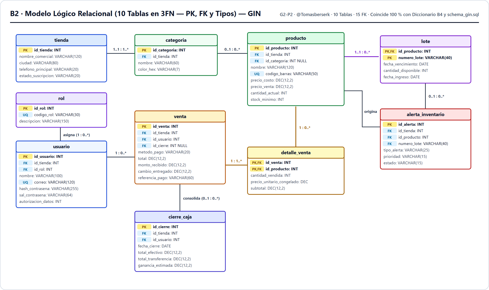

# B2 · Modelo Lógico Relacional y Cuadro de Reglas de Transformación — GIN (TiendApp)

**Producto:** G2-P2 · Modelo de datos y verificación  
**Autor (GitHub):** `@Tomasberserk`  
**Fuente editable (Draw.io):** [`02-modelo-logico-relacional.drawio`](./02-modelo-logico-relacional.drawio)  
**Imagen exportada:** [`02-modelo-logico-relacional.png`](./02-modelo-logico-relacional.png)

---

## 1. Esquema Relacional Transformado (10 Tablas — mínimo exigido: 8)

1. **`tienda`**(`PK id_tienda`, `nombre_comercial`, `direccion`, `ciudad`, `telefono_principal`, `estado_suscripcion`, `fecha_creacion`)
2. **`rol`**(`PK id_rol`, `codigo_rol UQ`, `descripcion`)
3. **`usuario`**(`PK id_usuario`, `FK id_tienda`, `FK id_rol`, `nombre`, `correo UQ`, `hash_contrasena`, `sal_contrasena`, `telefono_contacto`, `autorizacion_datos`, `activo`)
4. **`categoria`**(`PK id_categoria`, `FK id_tienda`, `nombre`, `color_hex`, `icono`, `fecha_creacion`) — `UNIQUE(id_tienda, nombre)`
5. **`producto`**(`PK id_producto`, `FK id_tienda`, `FK id_categoria NULL`, `nombre`, `codigo_barras`, `unidad_medida`, `precio_costo`, `precio_venta`, `cantidad_actual`, `stock_minimo`, `activo`) — `UNIQUE(id_tienda, codigo_barras)`
6. **`lote`**(`PK,FK id_producto`, `PK numero_lote`, `fecha_vencimiento`, `cantidad_disponible`, `fecha_ingreso`)
7. **`cierre_caja`**(`PK id_cierre`, `FK id_tienda`, `FK id_usuario`, `fecha_cierre`, `total_efectivo`, `total_transferencia`, `ganancia_estimada`) — `UNIQUE(id_tienda, fecha_cierre)`
8. **`venta`**(`PK id_venta`, `FK id_tienda`, `FK id_usuario`, `FK id_cierre NULL`, `fecha_hora`, `metodo_pago`, `total`, `monto_recibido`, `cambio_entregado`, `referencia_pago`, `estado`)
9. **`detalle_venta`**(`PK,FK id_venta`, `PK,FK id_producto`, `cantidad_vendida`, `precio_unitario_congelado`, `subtotal`)
10. **`alerta_inventario`**(`PK id_alerta`, `FK id_tienda`, `FK id_producto`, `FK numero_lote NULL`, `tipo_alerta`, `prioridad`, `estado`, `fecha_generacion`, `fecha_resolucion`)

---

## 2. Cuadro de Reglas de Transformación Aplicadas (Conceptual → Lógico)

| # | Regla de transformación relacional | Caso concreto en GIN (TiendApp) | Resultado en el modelo lógico (`B2`) |
| :-: | :--- | :--- | :--- |
| 1 | **Entidad fuerte → Tabla propia con PK** | `TIENDA`, `ROL`, `USUARIO`, `CATEGORIA`, `PRODUCTO`, `VENTA`, `CIERRE_CAJA`, `ALERTA_INVENTARIO` | Cada entidad se transforma en una tabla singular en `snake_case` con llave primaria `id_<tabla>`. |
| 2 | **Relación N:M → Tabla intermedia con PK compuesta** | `VENTA` (`1..*`) incluye `PRODUCTO` (`0..*`) con cantidad, precio congelado y subtotal | Tabla intermedia `detalle_venta(id_venta FK, id_producto FK, cantidad_vendida, precio_unitario_congelado, subtotal)` con `PK (id_venta, id_producto)`. |
| 3 | **Relación 1:N obligatoria → FK `NOT NULL` en el lado N** | `TIENDA`–`USUARIO`, `ROL`–`USUARIO`, `TIENDA`–`CATEGORIA`, `TIENDA`–`PRODUCTO`, `USUARIO`–`VENTA` | Se migra la PK del lado 1 como FK obligatoria (`NOT NULL`) en la tabla del lado muchos, con `ON DELETE RESTRICT`. |
| 4 | **Relación 0..1:N opcional → FK anulable (`NULL`) en el lado N** | `CATEGORIA` (`0..1`) agrupa `PRODUCTO` (`0..*`); `CIERRE_CAJA` (`0..1`) consolida `VENTA` (`0..*`) | `producto.id_categoria` (`NULL`, `ON DELETE SET NULL`) y `venta.id_cierre` (`NULL`, `ON DELETE SET NULL`). |
| 5 | **Entidad débil → Tabla con PK compuesta (`FK padre + discriminador`)** | `LOTE` depende existencialmente de `PRODUCTO` | `lote(id_producto FK, numero_lote, ...)` con `PK (id_producto, numero_lote)` y `ON DELETE CASCADE`; referenciada por FK compuesta opcional `(id_producto, numero_lote)` desde `alerta_inventario`. |
| 6 | **Generalización (`Usuario` → `Tendero`, `Cajero`) → Tabla única con tabla catálogo `rol`** | Los atributos propios de `Tendero` y `Cajero` son mínimos y comparten autenticación y aislamiento multi-tienda | Estrategia *Single Table Inheritance* en `usuario` vinculada por `id_rol FK → rol(id_rol)`, evitando `JOIN` costosos en cada verificación de token (`RNF-01`, `RNF-04`). |
| 7 | **Atributo multivaluado eliminado en 1FN** | Un producto puede tener varios códigos de lote perecedero | Se modela en la tabla hija `lote` (1 fila atómica por lote) en lugar de una lista separada por comas en `producto`. |
